------------------------------------------------------------------------

# Walksheds in American Communities

The first segment of an open-source/open-science Master's Thesis project! The data generated (found in the `data` folder) will be used for the upcoming R package [walkshedUS](https://github.com/paezha/walkshedUS). The guide on how to use this repository and its notebooks to generate your own walkshed data for any city in the USA can be found below, so enjoy!

## A (work-in-progress) guide on using this repository + the notebooks!

Many of the files (specifically, the walksheds generated by the researchers) are too large to be included on GitHub. Hence, this work is here to allow anyone interested in generating this data on their own; aiming to make this work as open and reproducible as possible.

The main files for making this possible, that are included in this repository, are `00-Basic-Data.Rmd` and `01-Walkshed-Routing.Rmd` which can both be found in the notebooks folder.

## Notebook 00: Basic Data

Start by cloning this repository to your device (ensuring you have R and RStudio already installed). You can do this by navigating to the top left corner, and selecting the following buttons:

> File \> New Project \> Version Control \> Git

Then, in "Repository URL", input the link to this repository: [github.com/rorata/walksheds-in-american-communities](https://github.com/rorata/walksheds-in-american-communities){.uri}, and select where to keep this project on your device.

If the project doesn't automatically open, navigate to wherever you have cloned the `walksheds-in-american-communities` repository, and within the folder, click the `walksheds-in-american-communities.Rproj` file to open it in R.

Then, navigate to the notebooks folder and open `00-Basic-Data.Rmd`, which will be the first R notebook you will need to use in this project.

#### Initial setup

You will need to access the pre-existing packages (that are saved at specific versions, ensuring that you are using the same exact packages + versions as the researchers). For this, you will install the "renv" package by entering this into the console at the bottom of your screen:

```         
install.packages("renv") renv::init()
```

Next, in the console, type:

```         
renv::restore()
```

Then, select the option to install the packages (which should be listed as the first option) by typing 1 in the console and confirming the choice if prompted.

#### Inputting the parameters

You will notice at the top of the notebook are several blank parameters in the `params` section, which you will have to enter. The blank parameters are as follows:

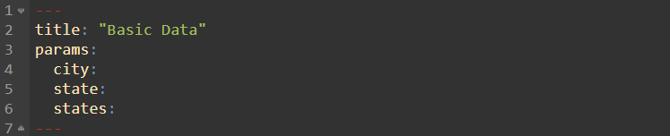

This guide will use Philadelphia to demonstrate how to configure the notebooks and obtain its walksheds (which you can then replicate for any city within the USA). You will need to input an answer for city, state, and states. City defines which metropolitan area you will be examining. For instance, Philadelphia's MSA (metropolitan statistical area) is technically called "Philadephia--Camden--Wilmington" due to several major cities being present within the given MSA. However, inputting Philadelphia will suffice, as the R packages included will detect the Philadephia metropolitan area (whereas trying to input the full name may actually cause it to malfunction and not detect any MSA/city).

For state, input the primary state the city is in. Philadelphia is in Pennsylvania. Do not include multiple states in this one.

For states, you will have to select one of two options: - For MSAs fully encapsulated in one state (e.g. Phoenix, Arizona; or Los Angeles, California), just input the same state you wrote for the state parameter directly above it. - For MSAs that span several states (such as Philadelphia), you will have to list all states present, along with a preceder to allow R to read this list correctly. For instance, Philadelphia's MSA is within 4 states: Pennsylvania, New Jersey, Delaware, and Maryland. So, in the states section, we will list it as so: Include the preceder which is `!r c` which does two things: 1. It is read as R code (which is needed for a list, but not needed for `city` and `state`), and 2. `c` allows the list following it to be interpreted as a list. Then, include the states. Each state will be in quotation marks, and at the start and end of the list there will be brackets. So, for Philadelphia, this will look as follows:

`!r c("Pennsylvania", "New Jersey", "Delaware", "Maryland")`

For obtaining the full list of states an MSA is in, there are two methods. The first is to check the Walkshed_Info_WIP.xlsx file included in this repository, which will have the states listed for \~40 of some of the most populous MSAs in the USA.

The other method, especially for cities not included in the aforementioned Excel file, is to skip this step for now, finish setting up your environment and run this notebook. You can then navigate to the 'cbsa' variable in your environment to check the "NAME10" column to see if the city lists any other states. If it does, go back and edit the "states" param to include all associated states. Then, rerun the notebook.

Once done, your parameters should be formatted similar to this:

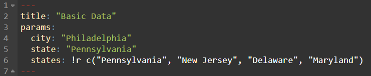

#### US Census API key

When you reach line 54, you will see the following chunk of code:

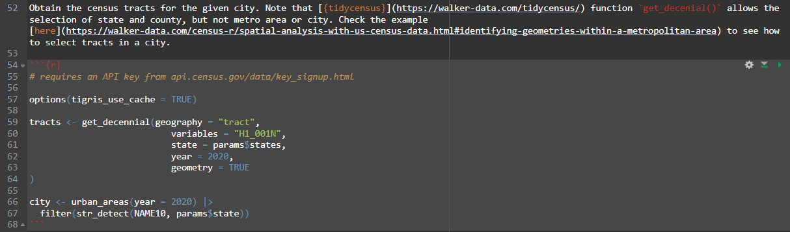

Despite having the necessary packages being installed by now, this chunk will not run without an API key for the US Census data you will be obtaining. The API key, which allows a user of an application or set of data (such as the US Census) to be authorized, can be obtained from the following [API Census website](api.census.gov/data/key_signup.html). Navigate to it, fill out the organization name and email address information, and wait for the key to be sent to your email.

Once you have the API key (which will be a long, randomized code), navigate back to RStudio. Now, in your console at the bottom of the screen, type in the following command to add this API key to your workspace, ensuring you add in your API key in the quotation marks:

```         
tidycensus::census_api_key("insert_census_key_here", overwrite = TRUE, install = TRUE)
```

More information on what API keys are + what they do, and how to add them to your environment can be found in this [YouTube video](https://www.youtube.com/watch?v=Bkg4x8d1zeA).

#### Downloading and adding the RUCA data table

RUCA stands for Rural-Urban Commuting Area Codes – and it's a tool crated by the USDA Economic Research Service to rank each census tract in the USA as metropolitan/urban (1) to rural (10), with the values in between consisting of: metropolitan commuting (2, 3), micropolitan (4), micropolitan commuting (5, 6), small town (7), small town commuting (8, 9). Although an R package for importing RUCA values into R exists, it is not for the census tract level, so we have to go onto the [USDA website](https://www.ers.usda.gov/data-products/rural-urban-commuting-area-codes) to download this data and import it ourselves.

Scroll to the bottom, and download the 2020 RUCA table for census tracts and as a CSV file, as seen below:

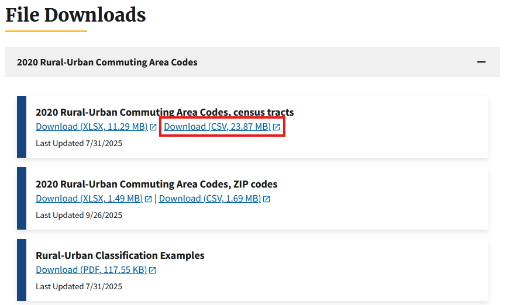

Then, find this repository/project's location in your computer, and navigate to it. Paste the file into walksheds-in-american-communities/notebooks (temporary location, as it is the only one that worked so far but will be moved to a more appropriate folder in this repository later). Then, rename it to RUCAcodes.csv.

In our project, we will be keeping tracts for RUCA values 1-6 (metropolitan + micropolitan and their commuting zones, but not small town or rural tracts). However, if you wish to remove more or less of these values, modify this chunk of code found on line 283 (with the numbers in the bracket provided being the ones that will be excluded):

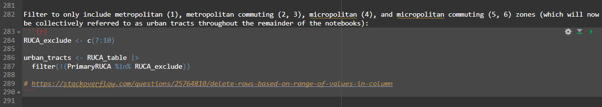

#### Running the notebook

Once all of the preliminary setup is complete, you can now run the notebook. However, for notebook-00, I would advise hitting the 'run all' button at the top. This is because at one point, we may have to manually filter out any unrelated metropolitan statistical areas (MSAs) that show up on the screen. Hence, I recommend doing the following instead:

- Scroll to line 123 and click on the blank line, where you will see the two following chunks of code:

  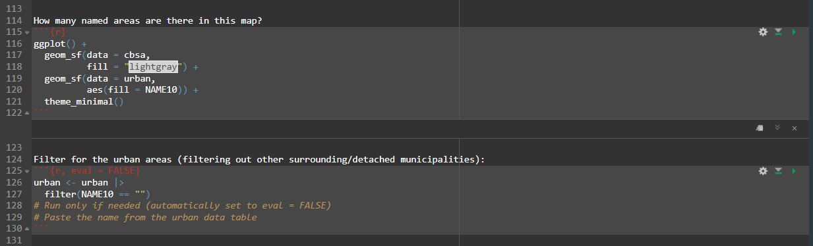

- Next, press the "Run All Chunks Above" button, which will run all chunks of code above line 123 (including the one that will show you if other MSAs are present in your dataset). As you can see, for Philadelphia, two different MSAs show up, as seen here:

  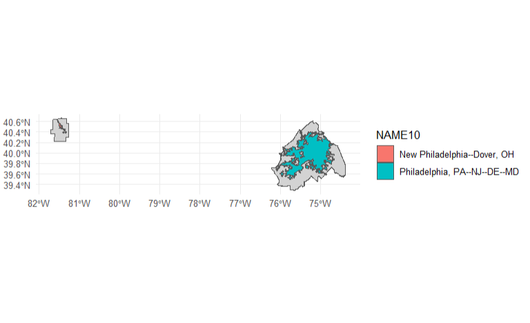

- If only one MSA shows up on your screen, just skip these next instructions and read the last bullet point of this list. If you have multiple MSAs, then navigate to the right side of your screen to the 'Environment' section and click `urban`, which will open up a dataframe of the detected MSAs.

  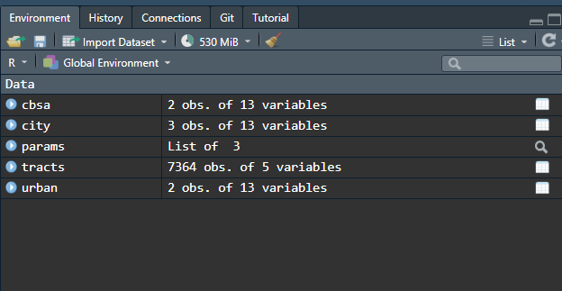

- Next, find which of the MSAs you will be using (you will only be using one). In our case, it will be the "Philadelphia, PA--NJ--DE--MD" MSA highlighted here:

  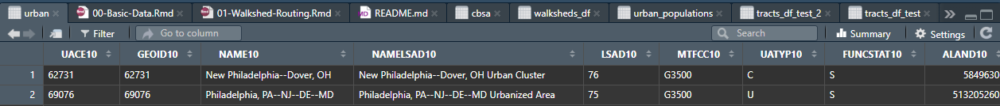

- So, from the "NAME10" column (and NOT the "NAMELSAD10" column), copy the text and head back to your 00-Basic-Data.Rmd notebook, and paste it into the quotation marks in the chunk on row 124, as seen below:

  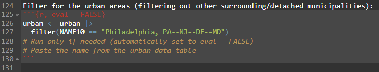

- This chunk is, by default, set as "eval = false" which means it will not run when you select 'run all' or similar options. Hence, run this one manually to filter out the other MSAs.

- In the Environment section, it should now show `urban` as a data object with only 1 entry. Once this is the case, you can then select "run all below" to run the remaining chunks of the notebook.

  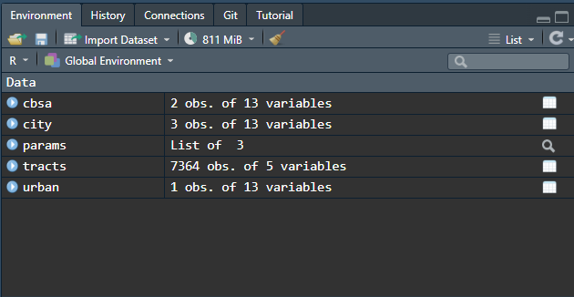

## Obtaining the OSM data

For routing the walksheds, we will need network data. In our case, we use data from OpenStreetMap (OSM). However, there is a process to obtaining the OSM data for the region we're working with.

We use a website called [bbbike](https://extract.bbbike.org/) to extract the OSM area we want to work with, as opposed to downloading the full data for one or more states (which may not be feasible, and would take up a lot more space than needed).

So, in notebook 00, on line 396, you can find code that calculates the bounding box of the area we are working with. There is a buffer zone of 1000 meters added as well, in case the walkshed extends past the most exterior tracts (of the MSA). The coordinates of the bbox are then outputted, and can be input into bbbike.

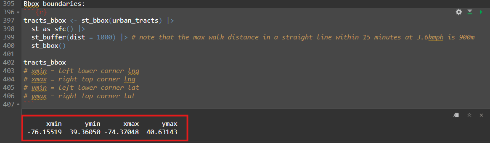

Additionally, you can see what the tracts and its bounding box look like in the ggplot map below this chunk of code, as seen here:

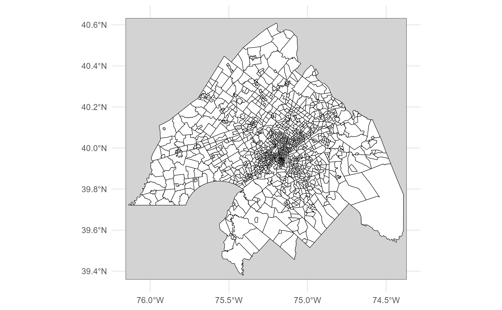

Going back to the bbox coordinates, you will notice four outputs in the following order:

1.  **xmin** (this will be the left-lower corner longitude)
2.  **ymin** (this will be the left-lower corner latitude)
3.  **xmax** (this will be the right-top corner longitude)
4.  **ymax** (this will be the right-top corner latitude)

Now, navigate to the [bbbike](https://extract.bbbike.org/) website. Search for your given area, and select one of the options for applies (such as seen below, and in this case, either 1 or 2 will be fine since you will be manually changing the coordinates regardless).

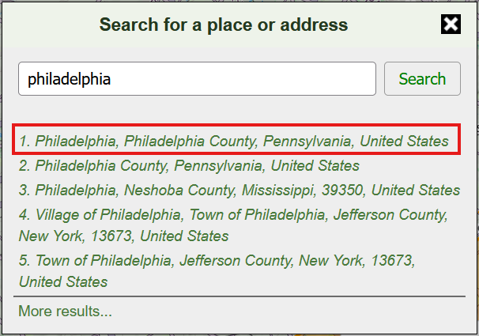

This is how the bounding box will initially look (likely not encompassing the entire region you will be working with):

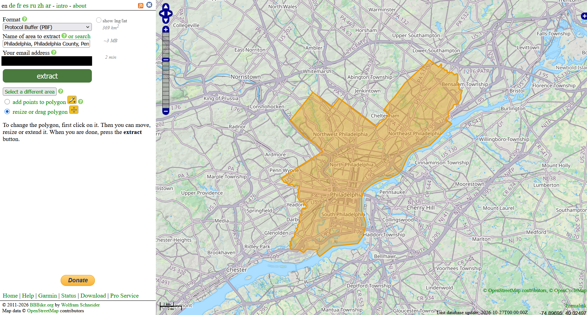

Next, select "show lng/lat" and input your corresponding coordinates, changing the bounding box to correspond to the geographic area you will be working with, as seen below:

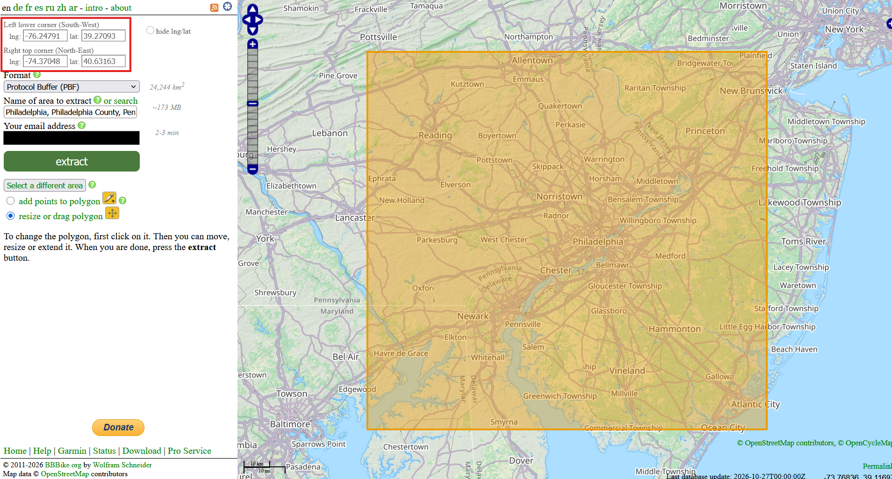

Then, select the format to be "Protocol Buffer (PBF)" and type in your email address, then extract the OSM PBF file to your email. Within a few minutes, you should receive a link to download the network file. Once it is on your device, navigate to "walksheds-in-american-communities/data-raw/r5_graph" (create the r5_graph folder if not initially present). Then, within the r5_graph folder, create a folder for your city (without including the state names). For instance, for Philadelphia, your folder path should look as such:

`/walksheds-in-american-communities/data-raw/r5_graph/Philadelphia`

Then, move the PBF file you just downloaded into the `r5_graph/city_name` folder. This step is now complete for now, and in notebook 01 later, you will utilize this file to create a network and use it for your walkshed routing for each tract you're examining.

## Notebook 01: Walkshed Routing

This notebook will be much easier to run than the last (primarily since everything has already been set up -- the packages, the API key, and we now have the preliminary data-raw files such as the cbsa and tracts files ready to use for the routing; and by now you hoepfully have the OSM PBF file input into the correct folder as well).

So, now, you should be able to type in the selected city in the params section (do not include the state names) and then press the run all button. This notebook will generate the walksheds for each census tract of the city, and will then calculate the areas of each walkshed to attach it to its associated census tract (as you will see in the tracts_df file that will be saved afterwards as walksheds_df.rda). The walksheds.rda file will be the shapefiles of the walkshed polygons themselves, and contain no other information about the walksheds or their associated tracts (and are much larger in size than the walksheds_df.rda files).
